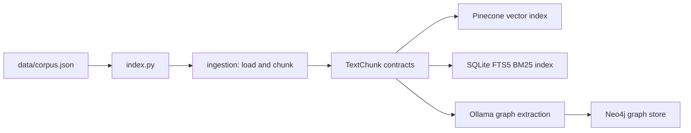
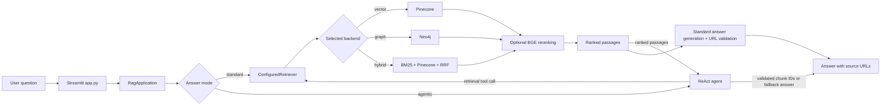

# Agentic AI for Enterprise

A document-grounded RAG assistant with interchangeable vector, graph, and hybrid retrieval. The repository separates corpus preparation and indexing from query-time retrieval, answer generation, and benchmark evaluation.

## Architecture

The system has two primary flows: an offline flow that prepares and indexes the corpus, and an online flow that retrieves evidence and answers user questions.

### Indexing flow



Run one indexing command for the backend you plan to use. Vector indexing embeds chunks and stores them in Pinecone. Hybrid indexing writes the same chunks to Pinecone and the local SQLite BM25 index. Graph indexing extracts entities and relations from chunks and stores graph records in Neo4j. The `both` option indexes vector and graph stores; it does not include the hybrid BM25 index.

### Question-answering flow



At runtime, `app.py` loads settings and pipeline configuration, then reuses a `RagApplication` for the selected backend. The application creates a configured retriever. Hybrid retrieval runs lexical and semantic search and merges results with reciprocal-rank fusion (RRF); the configured reranker can then reorder candidates. Standard mode generates an answer from the selected evidence and validates citations against retrieved URLs. Agentic mode uses a bounded ReAct loop that can make focused retrieval calls; citations must reference chunk IDs retrieved during that run, which are mapped to source URLs. The UI displays citations as links.

The benchmark uses the same application and retrieval components, but drives them with fixed question splits and records quality and runtime metrics instead of serving chat requests.

## Module responsibilities

Paths in this table are relative to `src/agentic_ai_for_enterprise/`, except for the root-level `app.py`.

| Module | Responsibility |
|---|---|
| `app.py` | Streamlit chat interface. Lets the user choose vector, graph, or hybrid retrieval and renders answers with source links. |
| `config.py` | Defines `Settings` for service connections and `PipelineConfig` for backend, chunking, retrieval depth, reranking, ReAct limits, and benchmark splits. |
| `contracts.py` | Shared data models and the `Retriever` protocol: articles, chunks, retrieved passages, answers, traces, and pipeline results. |
| `application.py` | Application orchestration. Selects the backend, applies configured reranking, and connects retrieval to standard answer generation or the ReAct agent. |
| `index.py` | Indexing CLI. Loads and chunks the corpus, then writes to the requested backend or stores. |
| `ingestion/corpus.py` | Reads and validates corpus articles and canonicalizes document URLs. |
| `ingestion/chunking.py` | Splits articles into overlapping `TextChunk` records with stable document and chunk identifiers. |
| `retrievers/vector/pinecone_store.py` | Embeds chunks with Ollama and indexes or retrieves them through Pinecone. |
| `retrievers/bm25.py` | Local SQLite FTS5 storage and BM25 retrieval for lexical search. |
| `retrievers/hybrid.py` | Queries the vector and BM25 stores, then deduplicates and fuses their rankings with RRF. |
| `retrievers/graph/extraction.py` | Uses the configured Ollama model to extract structured entities and relations from chunks. |
| `retrievers/graph/schema.py` | Defines validated graph extraction and graph record structures. |
| `retrievers/graph/neo4j_store.py` | Creates the Neo4j schema and indexes or retrieves document evidence through the graph store. |
| `agent/prompts.py` | System instructions for the retrieval agent. |
| `agent/react.py` | Runs the bounded ReAct loop, invokes the retriever for follow-up queries, and assembles an evidence-backed answer. |
| `reranking/ollama.py` | Sends query and passage candidates to the configured llama.cpp BGE reranking endpoint and applies the returned order. |
| `response/answer.py` | Builds the answer-generation prompt, selects evidence within the context limit, and generates a structured response with Ollama. |
| `response/validation.py` | Enforces the response contract and restricts citations to retrieved document URLs; returns an insufficient-evidence response when validation fails. |
| `benchmark/dataset.py` | Loads benchmark questions and their gold answers and evidence URLs. |
| `benchmark/splits.py` | Creates deterministic development, validation, and test splits by question type. |
| `benchmark/runner.py` | Runs paired benchmark conditions and persists resumable per-question records and summaries. |
| `benchmark/metrics.py` | Calculates retrieval, answer, citation, latency, and model-call metrics. |
| `benchmark/__main__.py` | Benchmark CLI for tuning, comparison, final evaluation, and hybrid retrieval evaluation. |

## Runtime dependencies

- **Ollama** serves the configured generation and embedding models. Graph indexing also uses the generation model for structured entity and relation extraction.
- **Pinecone** stores vectors for vector and hybrid retrieval.
- **SQLite with FTS5** stores the local BM25 index for hybrid retrieval.
- **Neo4j** stores graph records for graph retrieval.
- **llama.cpp `llama-server`** serves the BGE reranking endpoint when reranking is enabled.

## Requirements and installation

- Python 3.12 or newer
- A Python SQLite build with FTS5 support for Hybrid RAG
- Ollama with the configured generation and embedding models
- `llama-server` from llama.cpp for BGE reranking
- Pinecone account and API key for Vector and Hybrid RAG
- Neo4j database and credentials for Graph RAG

Pull the local models:

```powershell
ollama pull qwen3:1.7b
ollama pull embeddinggemma:latest
ollama pull qllama/bge-reranker-v2-m3:latest
```

Install the application using the existing `uv` project:

```powershell
uv sync
```

Or with pip:

```powershell
python -m venv .venv
.\.venv\Scripts\Activate.ps1
python -m pip install -e .
```

Copy `.env.example` to `.env` and fill in the Pinecone and Neo4j values you use. `Settings.from_env()` reads only this application's settings and does not export unrelated `.env` entries into the process.

### Start the BGE reranker

Ollama does not expose a pairwise reranking API for this BGE model. Run its Ollama-stored GGUF file through llama.cpp's reranking endpoint:

```powershell
$modelLine = (ollama show --modelfile qllama/bge-reranker-v2-m3:latest | Select-String '^FROM ').Line
$modelPath = $modelLine -replace '^FROM\s+', ''
llama-server.exe -m $modelPath --embedding --pooling rank --reranking --host 127.0.0.1 --port 8080
```

Keep the server running while reranking is in use. The application calls `http://localhost:8080/v1/rerank`, configured by `RERANKER_BASE_URL`. Ollama continues to serve generation and embeddings.

## Build the retrieval indexes

Index each backend independently. The defaults are `data/corpus.json`, `configs/default.json`, 1,000-character chunks, and 150-character overlap.

```powershell
python -m agentic_ai_for_enterprise.index --backend vector
python -m agentic_ai_for_enterprise.index --backend graph
python -m agentic_ai_for_enterprise.index --backend hybrid
python -m agentic_ai_for_enterprise.index --backend both
```

Hybrid indexing writes chunks to Pinecone and to the local SQLite FTS5 index. Its default database path is `artifacts/index/hybrid_bm25.sqlite3`; change `hybrid_bm25_index_path` in `configs/default.json` to use another location. Re-indexing replaces the local BM25 contents with the current corpus chunks.

Indexing reads only the corpus file. `data/MultiHopRAG.json` is reserved for benchmark questions and scoring; its gold evidence is not used to build any retrieval index.

## Run the chat application

Start Streamlit after indexing the backend you want to use:

```powershell
python -m streamlit run app.py
```

The sidebar selects Vector RAG (Pinecone), Graph RAG (Neo4j), or Hybrid RAG (Pinecone + BM25). Chat uses Agentic RAG with the selected backend and configured reranker. For Hybrid RAG, every retrieval query searches BM25 and Pinecone, fuses the ranked results, and then applies the configured reranker. Answers include source URLs from the retrieved passages.

## Benchmark retrieval and answers

The benchmark stratifies questions by `question_type` into development, validation, and held-out test partitions (70/15/15, seed 42). Development runs evaluate retrieval and reranking without generating answers. Validation runs compare complete RAG pipelines, including answer and citation quality. The test partition is reserved for the final comparison.

The hybrid benchmark compares fused BM25 + vector retrieval with reranking disabled and enabled on the development split. It reports Evidence Recall@5/10, Precision@5/10, and nDCG@10. For each query, it retrieves up to `candidate_depth` passages from each source, fuses and deduplicates by chunk ID, then applies the configured reranker.

Run the hybrid retrieval evaluation after building the hybrid index and starting the selected vector and reranker services:

```powershell
python -m agentic_ai_for_enterprise.benchmark --phase hybrid --backend hybrid --split development --reranker both
```

Run a development sweep across vector and graph retrieval, with reranking off and on:

```powershell
python -m agentic_ai_for_enterprise.benchmark --phase tune --backend both --split development --reranker both
```

After selecting a backend and reranker setting, compare standard and Agentic RAG generation on validation questions:

```powershell
python -m agentic_ai_for_enterprise.benchmark --phase compare --backend selected --split validation --reranker selected
```

Use development retrieval metrics to narrow candidates, then review evidence, answer, citation, latency, and model-call metrics on validation. Set the chosen backend and frozen reranker state in `configs/default.json`. The final command compares standard RAG with Agentic RAG on the held-out test questions:

```powershell
python -m agentic_ai_for_enterprise.benchmark --phase final --backend selected --split test --reranker selected
```

Add `--limit 10` for an operational smoke run, or `--run-id <name>` to resume a matching run. Do not use a limited run to select a winning configuration. Each run writes a split manifest, per-question JSONL records, condition summaries, and an aggregate summary under `artifacts/benchmark/<run-id>/`. Development reports contain retrieval metrics and runtime counts. Validation and final reports also include normalized answer exact match, token F1, and citation precision and recall. Evidence and answer quality are reported separately; there is no weighted winner score.

## Configuration

`configs/default.json` controls the selected backend, reranker state, chunking, candidate and context depths, graph traversal depth, ReAct step limit, benchmark split, and SQLite index path. `.env` contains service connection details and model identifiers; use `.env.example` for the variable names and safe placeholders. Keep `.env` private.
